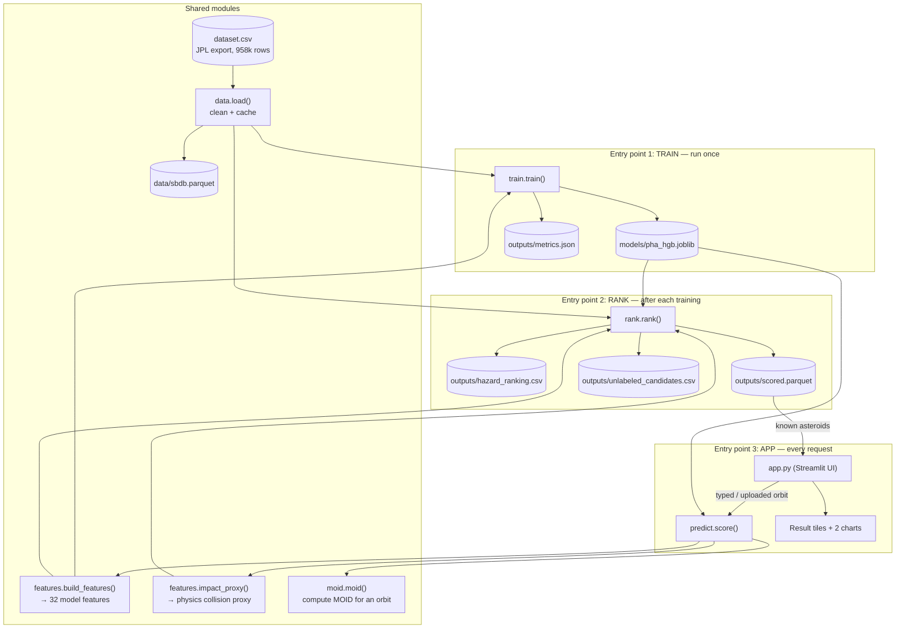

# neo-hazard — Detailed Guide

How the program turns an asteroid's orbit into a collision-hazard score: the
**input parameters**, **how the probability is calculated**, the **output
parameters**, and a **code flowchart** showing how the modules call each other
and what each one does.

This guide assumes no astrophysics background. Terms are defined the first time
they appear, and every formula matches the code in `src/neo_hazard/`.

---

## Table of contents

1. [The question in one paragraph](#1-the-question-in-one-paragraph)
2. [Units and symbols](#2-units-and-symbols)
3. [Input parameters](#3-input-parameters)
4. [How the probability is calculated](#4-how-the-probability-is-calculated)
   - [4a. The machine-learning probability `p_pha_ml`](#4a-the-machine-learning-probability-p_pha_ml)
   - [4b. The physics collision proxy](#4b-the-physics-collision-proxy)
   - [4c. Combining them into `hazard_score`](#4c-combining-them-into-hazard_score)
5. [Output parameters](#5-output-parameters)
6. [Code flowchart](#6-code-flowchart)
7. [Module-by-module reference (inputs and outputs)](#7-module-by-module-reference-inputs-and-outputs)
8. [Worked example](#8-worked-example)
9. [Limitations](#9-limitations)

---

## 1. The question in one paragraph

An asteroid can only threaten Earth if **(a)** its orbit around the Sun passes
close to Earth's orbit, and **(b)** it is large enough to survive the atmosphere.
The program measures both from the object's **orbital elements** (the numbers that
describe its orbit) and its **brightness** (a stand-in for size), then produces a
single `hazard_score` for ranking. The score combines a machine-learning
probability that the object is "potentially hazardous" with a physics estimate of
how likely its path is to actually intersect Earth's.

---

## 2. Units and symbols

| Symbol | Name | Meaning |
|---|---|---|
| **AU** | Astronomical Unit | Mean Earth–Sun distance, 149,597,870.7 km. Orbit sizes and gaps are in AU. |
| **LD** | Lunar Distance | Mean Earth–Moon distance, ~384,400 km. 1 AU ≈ 389.17 LD. |
| **°** | degree | Angles (inclination, node, perihelion argument) are in degrees. |
| **a** | semi-major axis (AU) | Half the long axis of the elliptical orbit = its average size. |
| **e** | eccentricity | Shape of the ellipse: 0 = circle, →1 = very elongated, ≥1 = open (escapes). |
| **i** | inclination (°) | Tilt of the orbit relative to Earth's orbital plane (the *ecliptic*). |
| **Ω (om)** | longitude of ascending node (°) | Where the orbit crosses the ecliptic going north. |
| **ω (w)** | argument of perihelion (°) | Angle from that crossing to the orbit's closest point to the Sun. |
| **q** | perihelion distance (AU) | Closest approach to the Sun: `q = a(1 − e)`. |
| **Q (ad)** | aphelion distance (AU) | Farthest point from the Sun: `Q = a(1 + e)`. |
| **n** | mean motion (°/day) | How fast it moves along the orbit on average. |
| **H** | absolute magnitude | Brightness normalized to fixed distances. **Lower H = brighter = bigger.** |
| **MOID** | Minimum Orbit Intersection Distance (AU) | Closest gap between the two *orbits* (not the bodies). |
| **PHA** | Potentially Hazardous Asteroid | Official label: `MOID ≤ 0.05 AU AND H ≤ 22`. |
| **NEO** | Near-Earth Object | `q < 1.3 AU`. |
| **U** | Öpik encounter speed (km/s) | Speed at which the object would meet Earth. |

---

## 3. Input parameters

### 3.1 Required inputs (per object)

These six numbers fully define where the orbit sits in space, plus size. They are
what you type in the web app's "Enter orbit" mode or put in a CSV
(`REQUIRED = ["a", "e", "i", "om", "w", "H"]` in `predict.py`).

| Input | Unit | Typical range | What it controls |
|---|---|---|---|
| `a` | AU | 0.5 – 50 | Overall size of the orbit. |
| `e` | — | 0 – 0.99 | How elongated the orbit is. |
| `i` | ° | 0 – 180 | How tilted it is vs. Earth's plane. |
| `om` (Ω) | ° | 0 – 360 | Orientation of the tilt (where it crosses the plane). |
| `w` (ω) | ° | 0 – 360 | Where the closest-to-Sun point sits along the orbit. |
| `H` | mag | 10 – 30 | Brightness → size. H ≈ 22 is ~140 m. |

When scoring the full catalogue (`rank.py`), these come straight from
`dataset.csv`. When scoring a user orbit (`predict.py`), only these six are
required and everything else below is derived or defaulted.

### 3.2 Derived inputs (computed automatically)

`predict.complete_elements()` fills these in so a user only has to supply the six
required numbers:

| Derived | Formula | Code |
|---|---|---|
| `q` (perihelion) | $q = a(1-e)$ | `predict.py:27` |
| `ad` (aphelion, Q) | $Q = a(1+e)$ | `predict.py:28` |
| `per_y` (period, years) | $P = a^{1.5}$ (Kepler's third law) | `predict.py:29` |
| `n` (mean motion, °/day) | $n = 0.9856076686 / P$ | `predict.py:30` |
| `moid` | computed by `moid.moid()` if not supplied | `predict.py:39` |

### 3.3 Optional inputs (orbit uncertainties)

Orbits are measured, not known exactly. These "sigma" columns say how uncertain
each element is, and they feed both the model and the collision proxy. If you
don't provide them, `predict.py` fills them with the median of all known NEOs.

`SIGMA_COLS = ["sigma_e", "sigma_a", "sigma_q", "sigma_i", "sigma_om",
"sigma_w", "sigma_ma", "sigma_n", "sigma_tp"]`, plus `rms` (the overall
orbit-fit residual). Two of them, `sigma_q` and `sigma_e`, directly drive the
MOID uncertainty in the collision proxy.

### 3.4 CSV upload format

| Column | Required? | Notes |
|---|---|---|
| `a, e, i, om, w, H` | **Yes** | The six required inputs. |
| `name` | No | Label shown in the app. |
| `moid` | No | If given, used directly (more accurate than the built-in calculator). |
| `sigma_*`, `rms` | No | Orbit uncertainties; default to NEO medians if absent. |

---

## 4. How the probability is calculated

There are **two independent engines**, combined at the end:

- **`p_pha_ml`** — a machine-learning probability (0–1) that the object is a PHA.
- **The physics proxy** — a probability that the orbit truly intersects Earth's
  capture zone, scaled by how often the object comes around.

```
hazard_score = p_pha_ml  ×  impact_proxy_per_yr
               └ ML part ┘    └──── physics part ────┘
```

### 4a. The machine-learning probability `p_pha_ml`

**Model:** scikit-learn `HistGradientBoostingClassifier` — a *gradient-boosted
decision-tree ensemble*. It is a long chain of small yes/no decision trees (637 of
them after early stopping); each new tree corrects the combined mistakes of all
the trees before it. Their outputs are summed and squeezed into a probability
between 0 and 1. Configured in `train.py:26`:

```python
HistGradientBoostingClassifier(
    max_iter=1000,          # up to 1000 trees
    learning_rate=0.05,     # each tree nudges the answer 5%
    max_leaf_nodes=63,      # tree size
    l2_regularization=1.0,  # penalty that limits overfitting
    early_stopping=True,    # stop when validation score plateaus
    validation_fraction=0.1,
    n_iter_no_change=50,
    scoring="average_precision",
    random_state=42,        # fixed seed → fully reproducible
)
```

**What it is trained on:** the 938,603 objects that carry an official PHA label.
The target `y` is the PHA flag (1 or 0). The data is split 80/20 (stratified, so
both halves keep the same 0.2% share of PHAs): 750,882 objects to train on,
187,721 held back as a final exam.

**Why MOID is deliberately excluded from the inputs:** the PHA label is *defined*
as `MOID ≤ 0.05 AU AND H ≤ 22`. That rule reproduces 99.99% of the labels. If the
model were shown MOID it would simply copy the rule and learn nothing. So MOID,
`pha`, `neo`, and `class` are withheld, forcing the model to infer close-approach
geometry from the orbit shape alone.

**The 32 input features** (`features.build_features`): every number the model
sees. All are derived purely from the orbital elements, brightness, and
uncertainties.

| # | Feature | Formula / source | Why it helps |
|---|---|---|---|
| 1–11 | `e, a, q, ad, i, om, w, n, per_y, H, rms` | passed through as-is | Raw orbit shape, size, brightness, fit quality. |
| 12 | `log_a` | $\log_{10}|a|$ | Compresses the huge range of orbit sizes. |
| 13 | `sin_i` | $\sin i$ | Smooth encoding of tilt. |
| 14 | `cos_w` | $\cos \omega$ | Smooth encoding of perihelion direction… |
| 15 | `sin_w` | $\sin \omega$ | …(angles wrap at 360°, so sin/cos avoid a false jump). |
| 16 | `node_asc_minus_1au` | $r_{asc} - 1$ | Ascending-node distance vs. Earth's 1 AU. |
| 17 | `node_desc_minus_1au` | $r_{desc} - 1$ | Descending-node distance vs. 1 AU. |
| 18 | `min_node_dist_1au` | $\min(|r_{asc}-1|, |r_{desc}-1|)$ | **Most important feature** — closeness of either crossing to Earth's orbit. |
| 19 | `q_minus_1au` | $q - 1$ | Does it dip inside Earth's orbit? |
| 20 | `Q_minus_1au` | $Q - 1$ | Does it reach outside Earth's orbit? |
| 21 | `crosses_1au` | $1$ if $q \le 1 \le Q$ else $0$ | Straddles Earth's distance. |
| 22 | `tisserand_j` | $T_J = \frac{a_J}{a} + 2\cos i\sqrt{\frac{a}{a_J}(1-e^2)}$, $a_J=5.2026$ | Classifies asteroid vs. comet-like orbits. |
| 23 | `opik_U_kms` | $U = V_\oplus\sqrt{3 - \frac1a - 2\sqrt{a(1-e^2)}\cos i}$, $V_\oplus=29.78$ | Encounter speed with Earth. |
| 24–32 | `log_sigma_*` (9 columns) | $\log_{10}(\sigma)$ of each element | How well the orbit is known. |

Node distances (features 16–18) use, with $p = a(1-e^2)$:

$$r_{asc} = \frac{p}{1 + e\cos\omega}, \qquad r_{desc} = \frac{p}{1 - e\cos\omega}$$

**Output:** `model.predict_proba(X)[:, 1]` → `p_pha_ml`, one probability per object.

**How good it is** (on the 187,721 held-out objects, 413 of them real PHAs):

| Metric | Value | Plain meaning |
|---|---|---|
| ROC-AUC | 0.9999 | Chance a random PHA scores above a random non-PHA (flattered by many easy non-PHAs). |
| PR-AUC | 0.955 | Precision–recall balance across all cut-offs; the honest score for a rare class. |
| Precision @ 0.5 | 0.90 | Of objects flagged, 90% really are PHAs. |
| Recall @ 0.5 | 0.84 | Of real PHAs, 84% are caught. |

Confusion matrix at the 0.5 cut-off: 347 caught, 66 missed, 37 false alarms,
187,271 correctly cleared.

### 4b. The physics collision proxy

Computed by `features.impact_proxy()` — pure physics, no machine learning. Three
steps.

**Step 1 — Earth's capture radius.** Earth's gravity bends nearby trajectories
inward, so the effective target is bigger than Earth itself. With Earth radius
$R_\oplus = 6371$ km $= 4.26\times10^{-5}$ AU and escape speed
$v_{esc} = 11.19$ km/s:

$$r_{cap} = R_\oplus\sqrt{1 + \left(\frac{v_{esc}}{U}\right)^2}$$

Slower encounters (small $U$) give a larger capture radius. $U$ is floored at
**1 km/s** (`MIN_ENCOUNTER_KMS`) so the formula can't blow up for orbits that
barely cross — this floor is the fix applied after the first version over-inflated
a few capture radii to millions of km. Typical NEO value: ~9,500 km; capped at
~72,000 km.

**Step 2 — probability the true MOID is inside the capture radius.** The catalogue
MOID $m$ is uncertain. Its uncertainty is combined from the element errors:

$$\sigma = \sqrt{\sigma_q^2 + (a\,\sigma_e)^2 + \sigma_{extra}^2}$$

($\sigma_{extra}$ is only added when MOID was computed locally — see 4d.) Treating
the true MOID as a normal distribution centred on $m$ with spread $\sigma$, the
probability it lands within $\pm r_{cap}$ is (with $\Phi$ the normal CDF):

$$p_{cross} = \Phi\!\left(\frac{r_{cap}-m}{\sigma}\right) - \Phi\!\left(\frac{-r_{cap}-m}{\sigma}\right)$$

This is `p_moid_within_capture` in the output.

**Step 3 — scale by encounters per year.** An object that laps the Sun more often
gets more chances:

$$\text{impact\_proxy\_per\_yr} = \frac{p_{cross}}{P}, \qquad P = a^{1.5}\ \text{(years)}$$

### 4c. Combining them into `hazard_score`

$$\boxed{\text{hazard\_score} = p\_pha\_ml \times \text{impact\_proxy\_per\_yr}}$$

- The ML term says "does this look like a hazardous object?" (big, crosses Earth).
- The physics term says "how likely and how often could its path actually meet
  Earth?"
- Multiplying pushes small objects (high H) and distant orbits down the ranking,
  even if one factor alone is high. Objects are then sorted by `hazard_score`
  descending, ties broken by `p_pha_ml`.

**This is a relative ranking, not a real impact probability.** A true impact
probability needs orbit *propagation* decades forward (timing of where both bodies
actually are), which NASA's Sentry system does and this project does not.

### 4d. How MOID is calculated for a user's orbit

If you enter an orbit without a MOID, `moid.moid()` computes it:

1. Sample 720 points along the object's orbit and 360 along Earth's.
2. Measure all pairwise distances; take the closest grid cell in each quarter of
   the orbit (MOID can have up to 4 local minima).
3. Refine each with a Nelder–Mead search; keep the smallest.

Accuracy vs. JPL's own MOIDs: **median error ~1×10⁻⁴ AU, 95th percentile
~6×10⁻⁴ AU**, 100% agreement on the 0.05 AU PHA threshold. Because that error
(~0.0003 AU) is larger than the capture radius (~0.00005 AU), a
`COMPUTED_MOID_SIGMA_AU = 3e-4` term is added to $\sigma$ so the proxy honestly
reflects the imprecision. Supply JPL's MOID in a CSV for an exact answer.

---

## 5. Output parameters

### 5.1 `outputs/hazard_ranking.csv` — one row per object, most hazardous first

| Column | Unit | Meaning | How to read it |
|---|---|---|---|
| `full_name` | — | Catalogue number + name | e.g. `89959 (2002 NT7)`. |
| `class` | — | Orbit family | APO/ATE/AMO are near-Earth; MBA/etc. are belt objects. |
| `neo` | 0/1 | Near-Earth flag | 1 = perihelion < 1.3 AU. |
| `pha` | 0/1/blank | Official hazardous flag | Blank = NASA hasn't labelled it. |
| `H` | mag | Brightness → size | Lower = bigger. |
| `diameter` | km | Measured size | Blank for ~86% of objects. |
| `moid` | AU | Closest orbit-to-orbit gap | < 0.05 = close. |
| `moid_ld` | LD | Same gap in lunar distances | < 1 = closer than the Moon. |
| `moid_sigma_au` | AU | Uncertainty of that gap | Larger = orbit less certain. |
| `capture_radius_au` | AU | How close it must pass to hit | ~0.00006 AU typical. |
| `p_moid_within_capture` | 0–1 | P(paths truly cross capture zone) | 1 = geometric intersection. |
| `impact_proxy_per_yr` | /yr | That probability × laps per year | Rough yearly "meeting chances". |
| `p_pha_ml` | 0–1 | **ML probability of being hazardous** | > 0.5 = model says hazardous. |
| `hazard_score` | — | **Final ranking number** | Higher = more worrying; compare objects, don't read as odds. |

### 5.2 `outputs/scored.parquet`

Same columns as the ranking **plus** `pdes, e, a, q, i, om, w, rms` and all
`sigma_*`. This is the fast binary file the web app loads; not meant to be opened
by hand.

### 5.3 `outputs/unlabeled_candidates.csv`

The 50 objects with **no** official PHA label, ranked by `p_pha_ml`. Columns:
`full_name, class, H, e, a, q, i, p_pha_ml`. In the current data all score below
0.00001 — no hidden threats.

### 5.4 `outputs/metrics.json`

The test scores from the last training run: `n_train`, `n_test`,
`test_positives`, `roc_auc`, `pr_auc`, `n_iter` (trees used), `report@0.5`
(precision/recall/F1), and `top_features_perm` (the 10 most important features).

### 5.5 Web-app result tiles

| Tile | Source column | Meaning |
|---|---|---|
| Hazard probability (ML) | `p_pha_ml` | Model's PHA probability. |
| MOID | `moid`, `moid_ld` | Orbit gap in AU and lunar distances. |
| Closer orbit than | computed | Percentile vs. all NEOs. |
| Miss distance / capture radius | `moid / capture_radius_au` | ≤ 1× means the orbits intersect. |
| P(orbit intersects Earth) | `p_moid_within_capture` | Uncertainty-aware intersection chance. |
| Hazard score | `hazard_score` | The ranking number. |

---

## 6. Code flowchart

How the modules call each other. There are **three entry points** — training,
ranking, and the web app — all sharing `data.py` and `features.py`.



**Reading the chart:**

- **Training** (`train.train`) loads the data, builds features, fits the model,
  and saves it. Run once.
- **Ranking** (`rank.rank`) loads the saved model, scores all 958k objects,
  attaches the physics proxy, and writes the output files. Run after each
  training.
- **The app** reads known asteroids straight from `scored.parquet`; for a
  typed-in or uploaded orbit it calls `predict.score`, which computes MOID
  (`moid.moid`), builds features, runs the saved model, and applies the proxy.
- `build_features` is used by training *and* both scoring paths, so the model
  always sees identical inputs.

---

## 7. Module-by-module reference (inputs and outputs)

### `data.py`

| Function | Inputs | Outputs | What it does |
|---|---|---|---|
| `load(csv_path, cache_path)` | paths (default `dataset.csv`, `data/sbdb.parquet`) | `DataFrame` (958,524 × 45) | Reads the CSV, strips names, maps `neo`/`pha` Y/N → 1/0, coerces numerics, caches to parquet. Rebuilds cache if the CSV is newer. |

### `features.py`

| Function | Inputs | Outputs | What it does |
|---|---|---|---|
| `node_distances(df)` | df with `a, e, w` | `(r_asc, r_desc)` Series (AU) | Heliocentric distance where the orbit crosses Earth's plane. |
| `opik_encounter_speed(df)` | df with `a, e, i` | Series (km/s) | Öpik encounter speed $U$ relative to Earth. |
| `build_features(df)` | df with orbital elements, `H`, `rms`, `sigma_*` | `DataFrame` of **32 features** | Assembles all model inputs (raw + derived + node geometry + log-uncertainties). **MOID is not included.** |
| `impact_proxy(df)` | df with `a, e, i, sigma_q, sigma_e, moid, per_y` | DataFrame: `capture_radius_au, moid_sigma_au, p_moid_within_capture, impact_proxy_per_yr` | The physics collision estimate (Section 4b). |

Constants: `R_EARTH_AU`, `V_EARTH_KMS = 29.78`, `V_ESC_EARTH_KMS = 11.19`,
`MIN_ENCOUNTER_KMS = 1.0`, `A_JUPITER = 5.2026`.

### `moid.py`

| Function | Inputs | Outputs | What it does |
|---|---|---|---|
| `orbit_points(a, e, i, om, w, f)` | elements + true anomalies `f` | array (len(f) × 3), AU | 3-D positions along an orbit. |
| `moid(a, e, i, om, w)` | one orbit's 5 elements | float (AU), or `nan` if `e ≥ 1` | MOID vs. Earth by grid search + Nelder–Mead refinement. |

`EARTH` holds Earth's J2000 elements used as the reference orbit.

### `train.py`

| Function | Inputs | Outputs | What it does |
|---|---|---|---|
| `train(seed=42)` | — (loads data internally) | writes `models/pha_hgb.joblib`, `outputs/metrics.json`; returns metrics dict | Splits 80/20, fits `HistGradientBoostingClassifier`, evaluates, computes permutation importance, saves. |

### `rank.py`

| Function | Inputs | Outputs | What it does |
|---|---|---|---|
| `rank(top_n=50)` | — (loads data + model) | writes `hazard_ranking.csv`, `scored.parquet`, `unlabeled_candidates.csv`; returns top-N DataFrame | Scores every object, attaches the proxy, computes `hazard_score`, sorts, writes files. |

### `predict.py`

| Function | Inputs | Outputs | What it does |
|---|---|---|---|
| `model()` | — | cached model | Loads the saved model once. |
| `complete_elements(df, defaults)` | df with the 6 required inputs | df with `q, ad, per_y, n, moid, moid_source, moid_extra_sigma`, filled `sigma_*` | Derives missing elements; computes MOID if absent. |
| `score(df, defaults)` | df of orbits + default sigmas | df + `p_pha_ml, capture_radius_au, moid_sigma_au, p_moid_within_capture, impact_proxy_per_yr, hazard_score, moid_ld` | Full scoring path for user orbits. |

`REQUIRED = [a, e, i, om, w, H]`; `COMPUTED_MOID_SIGMA_AU = 3e-4`.

### `app.py`

Streamlit UI. `load_neos()` reads `scored.parquet`; three input modes (known
asteroid, enter orbit, upload CSV); draws the orbit plot and the MOID-vs-H
population chart with Plotly. Known objects are read from the parquet; new orbits
go through `predict.score`.

---

## 8. Worked example

Asteroid **89959 (2002 NT7)**, which ranks 3rd of 958,524:

| Field | Value | Reading |
|---|---|---|
| `H` | 16.5 | Very bright → ~1.4 km across. |
| `moid` | 0.000027 AU | Paths pass within ~4,000 km of each other. |
| `capture_radius_au` | 0.000046 AU | Must pass within ~6,900 km to hit. |
| `p_moid_within_capture` | 1.0 | 4,000 < 6,900 km, so the paths genuinely cross. |
| `p_pha_ml` | 0.9988 | Model is 99.9% sure it's hazardous — **without being shown MOID.** |
| `hazard_score` | 0.437 | 0.9988 × 0.437; 3rd highest in the catalogue. |

It does **not** say 2002 NT7 will hit Earth — only that it's big and its path
crosses Earth's, so it deserves close watching. (It was briefly on NASA's risk
list in 2002 before more observations cleared it.)

---

## 9. Limitations

- **Relative ranking, not real odds.** No orbit propagation, planetary
  perturbations, or resonant returns. Use `hazard_score` to compare objects.
- **Most catalogued objects score 0.** A precise orbit that misses the capture
  radius gets exactly 0 — correct, and why Apophis and Bennu score 0.
- **Computed MOID is approximate (~±0.0003 AU).** Close typed-in orbits show
  inflated intersection probabilities; supply JPL's MOID for precision.
- **The label is PHA status, not impact.** The model learns what makes an object
  *potentially hazardous*, a proxy for collision risk.

For true impact probabilities, see
[NASA CNEOS Sentry](https://cneos.jpl.nasa.gov/sentry/).
